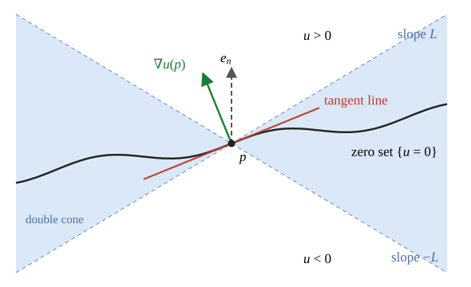

In [Part 1](/2026/11/16/Monotonicity-of-PDEs-Part-1-Serrin-on-Epigraphs.html), we proved vertical monotonicity for positive solutions of a Serrin problem on an epigraph under a monotonicity condition on $$f(s)/s$$ and (G). In this post we use that result twice, on both sides of the zero set of a solution of the **Allen–Cahn equation**

$$
-\Delta u=u-u^3
$$

in $$\mathbb R^n$$. The simplest solutions are the one-dimensional ones,

$$
u(x)=\tanh\left(\frac{x\cdot\xi-b}{\sqrt2}\right),\qquad |\xi|=1,\quad b\in\mathbb R.
$$

**De Giorgi's conjecture** (1978) says that monotonicity forces this rigidity in low dimensions: if $$\partial_nu>0$$ and $$n\le8$$, then $$u$$ is one of the solutions above.

## The converse question

If you believe in this conjecture or [OpenAI's proof](https://github.com/openai/math/blob/1581d4cbdd69a0faf34b2089614fe2a814316a6a/preprints/De-Giorgis-conjecture-in-dimension-eight-September-26-2026/article.pdf) of this conjecture, then the explicit form of the solutions above shows that the level sets of monotone solutions are parallel hyperplanes. In particular, the zero set is an entire graph,

$$
\{u=0\}=\{x_n=g(x')\}\qquad (\mathrm{N})
$$

for some $$g\in C^2(\mathbb R^{n-1})$$. This post is about the converse: **if we only know that the zero set is an entire graph, must $$u$$ be monotone?** A priori, (N) gives much less information. It says nothing about the other level sets, and nothing about $$u$$ far from the interface.

Questions of this type have been studied before. [Farina and Valdinoci](https://doi.org/10.1090/S0002-9947-2010-05021-4) proved that a monotone solution one of whose level sets is an entire graph is one-dimensional when $$n\le8$$. Very recently, [Farina](https://arxiv.org/abs/2611.01024) posted a manuscript, dated 2016, whose Theorem 11.2 proves by the sliding method that if the zero set of $$u$$ is the graph of a **uniformly continuous** function, then $$u$$ is one-dimensional in every dimension; in dimension two, continuity suffices (Remark 18 there). Some condition at infinity is necessary for flatness when $$n\ge9$$: the [del Pino–Kowalczyk–Wei](https://doi.org/10.4007/annals.2011.174.3.3) solutions have graphical zero sets that grow cubically in both directions. The theorem below shows that monotonicity, on the other hand, needs no condition on $$g$$ at infinity, in any dimension.

**Theorem (a graphical zero set forces monotonicity).** Let $$u\in C^2(\mathbb R^n)$$ solve $$-\Delta u=u-u^3$$, and suppose that (N) holds for some $$g\in C^2(\mathbb R^{n-1})$$. Then, up to replacing $$u$$ by $$-u$$, we have $$\partial_nu>0$$ in $$\mathbb R^n$$. If moreover $$n\le8$$, or there exists $C>0$ such that $$g(x')\le C(1+\lvert x'\rvert)$$ for all $$x'$$, or $$g(x')\geq-C(1+\lvert x'\rvert)$$ for all $$x'$$, then

$$
u(x)=\tanh\left(\frac{x\cdot\xi-b}{\sqrt2}\right)
$$

for some unit vector $$\xi$$ with $$\xi_n>0$$ and some $$b\in\mathbb R$$.

A uniformly continuous function grows at most linearly, so for $$C^2$$ graphs the flatness statement of the theorem includes Farina's theorem.

## Proof of the Theorem

Up to replacing $$u$$ by $$-u$$, which is again a solution, we may assume that $$u>0$$ above the graph of $$g$$ and $$u<0$$ below it. The idea is to apply [Part 1](/2026/11/16/Monotonicity-of-PDEs-Part-1-Serrin-on-Epigraphs.html) in each phase. Above the graph, $$u$$ is a positive solution of a Dirichlet problem in an epigraph. Below the graph, $$-u$$ is positive, and reflecting both the vertical coordinate and the sign of $$u$$ turns the lower phase into an epigraph as well. It is easy to check that $$f(s)=s-s^3$$ satisfies $$h(s)=f(s)-sf'(s)\ge 0$$ for $$s>0$$, and again (G) holds trivially as $$\lvert u\rvert<1$$ by Theorem 1.1 of [Farina](https://arxiv.org/abs/2611.01024).

**Step 1: the interface.** Let $$\Omega_+=\{x_n>g(x')\}$$ and let $$p$$ be a point of $$\partial\Omega_+$$. In $$\Omega_+$$ we have $$u>0$$ and $$-\Delta u=(1-u^2)u\geq0$$, and $$\Omega_+$$ satisfies the interior ball condition at $$p$$ because $$g\in C^2$$. Hopf's lemma gives $$\partial_\nu u(p)<0$$, where $$\nu$$ is the outer normal of $$\Omega_+$$. Since $$u$$ vanishes on $$\partial\Omega_+$$, its gradient is normal there, so

$$
\nabla u(p)=\partial_\nu u(p)\,\nu,\qquad
\nu=\frac{(\nabla g,-1)}{\sqrt{1+|\nabla g|^2}},\qquad
\partial_nu(p)=\frac{-\partial_\nu u(p)}{\sqrt{1+|\nabla g|^2}}>0 .
$$

**Step 2: the upper phase.** In $$\Omega_+$$, $$u$$ is a bounded positive solution of $$-\Delta u=f(u)$$, $$u=0$$ on $$\partial\Omega_+$$, and $$\partial_nu>0$$ on $$\partial\Omega_+$$ by Step 1. This is exactly the setting of [Part 1](/2026/11/16/Monotonicity-of-PDEs-Part-1-Serrin-on-Epigraphs.html). The quotient argument gives $$\partial_nu\geq0$$ in $$\Omega_+$$, and the strong maximum principle upgrades it to $$\partial_nu>0$$.

**Step 3: the lower phase, by a double reflection.** Define

$$
v(x',t)=-u(x',-t),\qquad \widetilde\Omega=\{(x',t):t>-g(x')\}.
$$

The point $$(x',t)$$ lies in $$\widetilde\Omega$$ exactly when $$(x',-t)$$ lies in $$\{u<0\}$$, so $$v>0$$ in the epigraph $$\widetilde\Omega$$ of $$-g\in C^2$$, and $$v=0$$ on its boundary. Since $$f$$ is odd, $$-\Delta v=v-v^3$$. Finally, the two minus signs cancel in the vertical derivative:

$$
\partial_tv(x',t)=\partial_nu(x',-t).
$$

The argument of [Part 1](/2026/11/16/Monotonicity-of-PDEs-Part-1-Serrin-on-Epigraphs.html) can thus be applied again to $$v$$, giving $$\partial_tv>0$$ in $$\widetilde\Omega$$, that is, $$\partial_nu>0$$ in $$\{u<0\}$$. Together with the preceding steps, this gives $$\partial_nu>0$$ throughout $$\mathbb R^n$$.

This completes the proof of monotonicity.

**Flatness.** By monotonicity, $$\partial_nu>0$$. Moreover, $$u$$ tends to $$\pm1$$ as $$x_n\to\pm\infty$$: by Lemma 11.3 of [Farina](https://arxiv.org/abs/2611.01024), a solution of the Allen–Cahn equation with $$0<u\le1$$ in a continuous epigraph tends to $$1$$ uniformly as the distance to the boundary tends to infinity; apply it to $$u$$ above the graph of $$g$$ and to $$-u$$ below it. These are exactly the hypotheses of [Savin's theorem](https://doi.org/10.4007/annals.2009.169.41), which gives that $$u$$ is one-dimensional when $$n\le8$$; see Theorem 1.3 of [Savin's 2016 note](https://arxiv.org/abs/1610.03448). For the one-sided linear bounds, Theorem 1.4 of the same note says that if, in addition, $$\{u=0\}\subset\{x_n<C(1+\lvert x'\rvert)\}$$, then $$u$$ is one-dimensional in every dimension. If $$g(x')\le C(1+\lvert x'\rvert)$$, this inclusion holds with $$2C$$ in place of $$C$$. If instead $$g(x')\geq-C(1+\lvert x'\rvert)$$, apply the same argument to $$\tilde u(x',x_n)=-u(x',-x_n)$$, which satisfies all the assumptions of the theorem with $$-g$$ in place of $$g$$. $$\square$$

**Remark on the regularity of $$g$$.** We assumed $$g\in C^2$$ only to apply Hopf's lemma in Step 1, which needs the interior ball condition. Local Lipschitz continuity of $$g$$ suffices, because of the following claim: *if $$g$$ is locally Lipschitz, then $$\nabla u\neq0$$ on the zero set.* Recall that $$u$$ is real-analytic by Theorem 1.1 of [Farina](https://arxiv.org/abs/2611.01024). Given the claim, let $$p$$ be a point of the zero set, so that $$p=(p',g(p'))$$. By the implicit function theorem, near $$p$$ the zero set is a $$C^1$$ hypersurface whose tangent plane is orthogonal to $$\nabla u(p)$$. Since it is also the graph of a function that is $$L$$-Lipschitz near $$p'$$, it lies near $$p$$ in the double cone $$\{\lvert x_n-g(p')\rvert\le L\lvert x'-p'\rvert\}$$, so every tangent vector $$v$$ satisfies $$\lvert v_n\rvert\le L\lvert v'\rvert$$. Hence $$e_n$$ is not tangent (as that would imply $$1\le 0$$), so it is not orthogonal to $$\nabla u(p)$$, which implies that $$\partial_nu(p)=\nabla u(p)\cdot e_n\neq0$$. As $$u>0$$ above the graph and $$u<0$$ below it, $$\partial_nu(p)\ge0$$, so $$\partial_nu(p)>0$$. Since $$u$$ is real-analytic and $$\partial_nu(p)\neq0$$, the analytic implicit function theorem in the variable $$x_n$$ now shows that $$g$$ is real-analytic near $$p'$$. In particular $$g\in C^2$$, so the original proof applies without change.

<figure style="text-align:center;margin:1.5em 0">

</figure>

*Proof of the claim.* Suppose, for a contradiction, that there is a point $$p$$ in the zero set with $$\nabla u(p)=0$$. By translating coordinates, we may assume that $$p=0$$, since the Allen–Cahn equation and the locally Lipschitz graph condition are preserved under translations. Thus $$u(0)=0$$ and $$\nabla u(0)=0$$.

**(a) The leading term is harmonic.** Since $$u$$ is real-analytic and not identically zero,

$$
u(x)=P(x)+O(\lvert x\rvert^{k+1})
$$

as $$x\to0$$, where $$P\not\equiv0$$ is a homogeneous polynomial of degree $$k\ge2$$. The right-hand side of $$-\Delta u=u-u^3$$ is $$O(\lvert x\rvert^k)$$, while $$\Delta P$$ is homogeneous of degree $$k-2$$. Hence $$\Delta P=0$$.

**(b) Blow-up.** The rescaled graphs $$g_r(x')=g(rx')/r$$ have the same local Lipschitz constant $$L$$ and satisfy $$g_r(0)=0$$. Thus Arzelà–Ascoli and a diagonal argument give a sequence $$r_j\to0$$ such that $$g_{r_j}\to G$$ locally uniformly, with $$G$$ Lipschitz and $$G(0)=0$$. Also $$u(r_jx)/r_j^k\to P(x)$$ locally uniformly.

Set $$D_+=\{x_n>G(x')\}$$ and $$D_-=\{x_n<G(x')\}$$. Passing the signs of $$u$$ to the limit gives $$P\ge0$$ in $$D_+$$ and $$P\le0$$ in $$D_-$$. Since $$P$$ is harmonic and not identically zero, the strong maximum principle makes these inequalities strict. Continuity then gives $$P=0$$ on the separating graph. Hence

$$
D_+=\{P>0\},\qquad D_-=\{P<0\},\qquad \{P=0\}=\{x_n=G(x')\}.
$$

**(c) Monotonicity from a spectral gap.** At any point $$x$$ of the zero graph, $$P(x+te_n)>0=P(x)$$ for $$t>0$$, so $$\partial_nP(x)\ge0$$. We want to propagate this boundary sign into both phases. Homogeneity makes $$D_\pm=\{\pm P>0\}$$ cones, with spherical cross-sections $$\Omega_\pm=D_\pm\cap S^{n-1}$$. On either cross-section $$\Omega$$, let $$p$$ be the positive restriction of $$P$$ or $$-P$$, and let $$q$$ be the restriction of $$\partial_nP$$. The polar-coordinate formula for homogeneous harmonic functions gives

$$
-\Delta_Sp=\lambda p,\qquad -\Delta_Sq=\mu q,
\qquad
\lambda=k(k+n-2),\quad \mu=(k-1)(k+n-3)<\lambda.
$$

Since $$p>0$$ inside and $$p=0$$ on the boundary, $$\lambda=\lambda_1(\Omega)$$: its inner product with a positive first eigenfunction is nonzero, so the two eigenvalues must agree by self-adjointness.

Now $$q\ge0$$ on $$\partial\Omega$$, so its negative part $$q_-=\max\{-q,0\}$$ belongs to $$H_0^1(\Omega)$$. Testing the equation for $$q$$ with $$q_-$$ and using the variational definition of $$\lambda_1$$ gives

$$
\lambda\int_\Omega q_-^2\,d\sigma
\le\int_\Omega\lvert\nabla_Sq_-\rvert^2\,d\sigma
=\mu\int_\Omega q_-^2\,d\sigma.
$$

Because $$\mu<\lambda$$, we must have $$q_-=0$$. Thus $$q\ge0$$ in $$\Omega$$. By homogeneity, $$\partial_nP\ge0$$ in both phases, and by continuity, the same holds throughout $$\mathbb R^n$$.

**(d) Conclusion.** Since $$\partial_nP$$ is either identically zero or a homogeneous polynomial of degree at least one, we have $$\partial_nP(0)=0$$. The nonnegative harmonic function $$\partial_nP$$ attains its minimum at the origin, so the strong minimum principle gives $$\partial_nP\equiv0$$. Thus $$P$$ is independent of $$x_n$$ and $$P(0,1)=P(0)=0$$. But $$G(0)=0$$ implies $$(0,1)\in D_+$$, where $$P>0$$, a contradiction. $$\square$$

## Beyond Allen–Cahn

We consider three extensions in turn:

1. General reactions satisfying the structural condition in both phases.
2. Coefficients that vary horizontally.
3. Reactions that vary vertically.

**General reactions.** For $$-\Delta u=f(u)$$ with a locally Lipschitz reaction $$f$$, the reflected reaction on the lower phase is $$f_-(s)=-f(-s)$$, and its structural quantity is $$f_-(s)-sf_-'(s)=-h(-s)$$. So the two-phase argument works whenever $s\,h(s)\geq0$ for a.e. nonzero $s$ in the range of $u$, together with (N) and (G) on each phase. Then $$\partial_nu>0$$ again.

**Inhomogeneous media.** Let $$A$$ and $$B$$ be locally bounded on $$\mathbb R^{n-1}$$ with $$B>0$$, and consider

$$
-\Delta u=A(x')\,u-B(x')\,u^3 .
$$

Local boundedness of $$A$$ and $$B$$ allows us to apply Hopf’s lemma in Step 1 near each point of the graph. For this reaction, it can be easily computed that

$$
s\,h(x^\prime,s)
=s\bigl[f(x^\prime,s)-s\,\partial_s f(x^\prime,s)\bigr]
=2B(x^\prime)s^4\geq0.
$$

The explicit spatial dependence of $$f(x^\prime,s)$$ is through $$x^\prime$$ alone, so $$\partial_n[f(x^\prime,u(x))]=\partial_s f(x^\prime,u(x))\,\partial_nu(x)$$. The quotient equation therefore has the same form as in [Part 1](/2026/11/16/Monotonicity-of-PDEs-Part-1-Serrin-on-Epigraphs.html), with $$h(x^\prime,u)$$ in place of $$h(u)$$, and the sign condition above allows the same argument in both phases. Thus every bounded solution whose zero set is an entire $$C^2$$ graph as in (N) satisfies $$\partial_nu>0$$.

**Stratified media.** Let $$f$$ and $$\partial_s f$$ be continuous on $$\mathbb R\times(0,\infty)$$, and assume that $$f(t,s)-s\,\partial_s f(t,s)\geq0$$ for every $$t\in\mathbb R$$ and $$s>0$$. Suppose that $$u\in C^2(\mathbb R^n)$$ is positive and solves

$$
-\Delta u=f(x_n,u)
$$

in $$\mathbb R^n$$. Assume also that $$u$$ satisfies (G). For a horizontal unit vector $$e$$, the reaction does not depend on $$x\cdot e$$, so $$\partial_e$$ commutes with the equation. Steps 1–6 of the proof in [Part 1](/2026/11/16/Monotonicity-of-PDEs-Part-1-Serrin-on-Epigraphs.html) apply in $$\Omega=\mathbb R^n$$ with the direction $$e$$, and Step 0 is not needed because there is no boundary. This gives $$\partial_eu\geq0$$. Applying the same argument to $$-e$$ gives $$\partial_eu\le0$$. Hence $$u$$ depends only on $$x_n$$.

## References

{: .article-references}
1. Ennio De Giorgi, *Convergence problems for functionals and operators*, Proceedings of the International Meeting on Recent Methods in Nonlinear Analysis (Rome, 1978), Pitagora, Bologna, 1979, 131–188.
2. Ovidiu Savin, [*Regularity of flat level sets in phase transitions*](https://doi.org/10.4007/annals.2009.169.41), *Annals of Mathematics* **169** (2009), 41–78.
3. Manuel del Pino, Michał Kowalczyk and Juncheng Wei, [*On De Giorgi's conjecture in dimension $$N\geq9$$*](https://doi.org/10.4007/annals.2011.174.3.3), *Annals of Mathematics* **174** (2011), 1485–1569.
4. Ovidiu Savin, [*Some remarks on the classification of global solutions with asymptotically flat level sets*](https://arxiv.org/abs/1610.03448), 2016.
5. Alberto Farina and Enrico Valdinoci, [*1D symmetry for solutions of semilinear and quasilinear elliptic equations*](https://doi.org/10.1090/S0002-9947-2010-05021-4), *Transactions of the American Mathematical Society* **363** (2011), 579–609.
6. Alberto Farina, [*On the classification of entire solutions to the Allen–Cahn equation in any dimension*](https://arxiv.org/abs/2611.01024), arXiv, October 2026 (manuscript dated March 2016).
7. OpenAI, [*A positive resolution of De Giorgi's conjecture in dimension eight*](https://github.com/openai/math/blob/1581d4cbdd69a0faf34b2089614fe2a814316a6a/preprints/De-Giorgis-conjecture-in-dimension-eight-September-26-2026/article.pdf), manuscript, September 26, 2026 (repository revision 1581d4c). Not peer-reviewed.
